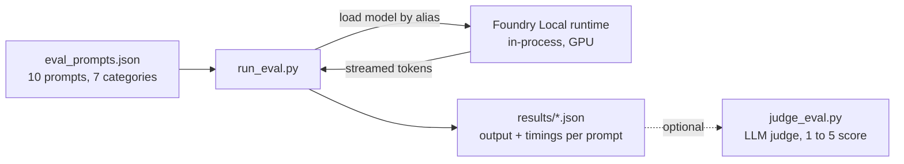

# Local LLM Benchmark

Run small language models fully on-device with [Foundry Local](https://learn.microsoft.com/en-us/azure/foundry-local/get-started), then measure them: load time, time to first token, response time and throughput across seven kinds of task.

No cloud account is needed for the chat app or the benchmark. After the first model download, everything works with Wi-Fi off.

## What is in the repository

| File | What it does |
|---|---|
| `smoke_test.py` | Checks the install end to end: SDK import, GPU execution provider, model download and cache, load, and one real completion |
| `chat_app.py` | Streaming chat UI at `http://localhost:8080`, built on the Python standard library, with a staged loading screen |
| `run_eval.py` | Benchmark runner: replays the prompt set against one model and records timings per prompt |
| `eval_prompts.json` | Ten prompts in seven categories, each with a note on the expected behaviour |
| `judge_eval.py` | Optional quality scoring with an LLM judge (needs an Azure OpenAI deployment) |
| `results/` | Raw result files from the recorded runs, including every model output |
| `summarize_results.py` | Rebuilds the two results tables below from `results/`, and checks that this README still matches them |
| `RUNBOOK_macOS.md` | Step-by-step setup on Apple Silicon, a GPU check, a reproduction checklist and a triage table |

## How the benchmark works



For each prompt the runner streams the completion and records:

- **Time to first token:** from request to the first streamed chunk.
- **Total time:** from request to the end of the stream.
- **Tokens per second:** streamed chunks divided by total time. Chunk count is an approximation of token count, close enough to compare models on the same machine.
- **Load time:** once per model, from `model.load()`.

## Recorded results

Three models, one run each, on 20 July 2026. Hardware: MacBook Pro, Apple M5, 32 GB memory, using the WebGPU execution provider (Metal).

| Model | Load time | First token (avg) | Response time (avg) | Slowest prompt | Tokens per second (avg) |
|---|---|---|---|---|---|
| Phi-3.5 mini | 6.1 s | 0.22 s | 6.8 s | 14.5 s | 46.5 |
| Phi-4 mini reasoning | 9.1 s | 0.22 s | 25.3 s | 45.5 s | 46.2 |
| Qwen 2.5 7B | 11.4 s | 0.39 s | 10.3 s | 28.6 s | 23.4 |

Average response time by category, in seconds:

| Category | Prompts | Phi-3.5 mini | Phi-4 mini reasoning | Qwen 2.5 7B |
|---|---|---|---|---|
| Multi-step reasoning | 2 | 7.0 | 45.0 | 13.8 |
| Structured output | 1 | 5.1 | 4.8 | 4.9 |
| Constraint following | 2 | 1.9 | 15.9 | 1.1 |
| Code | 1 | 13.3 | 45.5 | 28.6 |
| Grounded answering | 2 | 1.4 | 11.6 | 1.1 |
| Ambiguity handling | 1 | 14.4 | 17.2 | 18.0 |
| Summarization | 1 | 14.5 | 40.1 | 19.8 |

Both tables are generated from the files in `results/`. To rebuild them, or to confirm this page still matches the raw data:

```bash
python summarize_results.py            # print both tables
python summarize_results.py --check    # exit 1 if this README has drifted
```

The check needs only the Python standard library, and it runs on every push.

What the timings show:

- **First token is fast on all three.** Every model starts answering in under half a second, so perceived responsiveness depends on answer length, not start-up.
- **The reasoning model is slow because it writes more.** Phi-4 mini reasoning streams at the same rate as Phi-3.5 mini (about 46 tokens per second) but takes 3.7 times as long per answer.
- **The 7B model costs about half the throughput.** Qwen 2.5 7B streams at 23 tokens per second, yet on short constraint and grounded prompts it finishes as quickly as the smaller models.

## What these results do not show

- **Quality.** The table holds timings only. `judge_eval.py` can score answers, but no scored results are included here. Read the raw outputs in `results/` to judge quality yourself.
- **Statistical confidence.** Ten prompts, one run per model, one machine.
- **Exact token counts.** Throughput uses streamed chunks as a stand-in for tokens.
- **Other hardware.** Foundry Local serves a different model variant per device, so numbers will differ elsewhere.

## Quick start

Requires an Apple Silicon Mac with a native arm64 Python 3.10 to 3.12 and about 5 GB of free disk. `RUNBOOK_macOS.md` has the full walkthrough and the checks for each step.

```bash
git clone https://github.com/ArchitectsBench/local-llm-benchmark.git
cd local-llm-benchmark
python3 -m venv .venv && source .venv/bin/activate
pip install -r requirements.txt

python smoke_test.py          # first run downloads Phi-3.5 mini (about 2 GB)
python chat_app.py            # then open http://localhost:8080
```

Run the benchmark, once per model:

```bash
python run_eval.py --list-models
python run_eval.py --model phi-3.5-mini
python run_eval.py --model phi-4-mini-reasoning
python run_eval.py --model qwen2.5-7b
```

Each run writes `results/results_<model>_<timestamp>.json`.

### Optional: score answer quality

`judge_eval.py` generates a baseline answer from a cloud model for each prompt, then asks that model to score the local answer from 1 to 5 against the prompt, the expected-behaviour note and the baseline.

```bash
export AZURE_OPENAI_ENDPOINT="https://<resource>.openai.azure.com"
export AZURE_OPENAI_API_KEY="<key>"
export AZURE_OPENAI_DEPLOYMENT="gpt-4o"
python judge_eval.py results/results_phi-3_5-mini_*.json
```

This step calls a paid cloud service; the rest of the repository does not.

## Notes on the SDK

- The package is `foundry-local-sdk`; the import is `foundry_local_sdk`. A package named `foundry-local` on PyPI is unrelated.
- The code uses the in-process API from SDK 1.2: `FoundryLocalManager.initialize(...)`, then `catalog.get_model(alias)`, `model.load()` and `model.get_chat_client()`.
- On Apple Silicon the SDK selects the GPU path by itself. If generation is slow and GPU history stays flat, Python is probably running under Rosetta; the runbook explains how to check.
